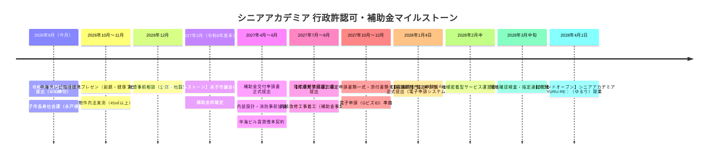

# 米子市長寿社会課 指定申請チェックリストと行政手続ガイド
**〜シニアアカデミア YURU-RE：（ゆるり）2028年春開業に向けた許認可・補助金完全マニュアル〜**

- **更新日**: 2026年9月10日
- **協議先**: 米子市役所 福祉保健部 長寿社会課 介護保険第二担当（担当：永戸様）
- **連絡先**: 〒683-8686 鳥取県米子市加茂町1丁目1番地（本庁舎1階 14番窓口） / TEL: 0859-23-5104 / Eメール: choju@city.yonago.lg.jp

---

## 1. 全体行政マスタータイムライン（2026.9 〜 2028.4）



---

## 2. 最優先直前タスク：令和9年度 高齢者施設整備補助金 希望調査

| 項目 | 内容 |
| :--- | :--- |
| **対象補助金** | 令和9年度 地域医療介護総合確保基金事業（介護施設等の整備に関する事業）補助金 |
| **提出書類** | 1. `01_補助事業事前希望申出書.docx`<br>2. `02_調査票_地域医療介護総合確保基金.xls` |
| **提出期限** | **令和8年（2026年）9月30日（水曜日）必着**（※期限を過ぎた場合、補助希望なしとみなされる） |
| **提出方法** | 米子市長寿社会課宛 Eメール：`choju@city.yonago.lg.jp`（永戸様窓口） |
| **対象事業** | 令和9年度内に着手（契約・発注）し、令和9年度内（2028年3月末まで）に完了する施設整備・改修工事 |
| **担当** | けいた |

---

## 3. 最重要関門：「密着委員会（米子市 地域密着型サービス運営委員会）」とは

- **根拠・位置づけ**:
  介護保険法および米子市条例に基づき、市内に新設される地域密着型サービス事業所の適格性、市計画との整合性、地域ニーズ等を有識者・地域代表からなる委員会で審査・意見聴取する公的関門です。
- **開催スケジュール**:
  米子市では年数回開催され、**令和9年度2月中（2028年2月）**に開催される委員会が、**2028年4月1日指定（オープン）のための審査対象**となります。
- **提出リミット**:
  2月の密着委員会で諮られるためには、**「前月開庁日（2028年1月4日）」までに不備のない指定申請書類一式が電子申請システムに提出されている必要があります**。
- **出席要否**:
  ガイドブック規定により、**事業者（ユルク）の委員会出席は原則不要**です。提出された書類一式（事業計画、運営規程、平面図、収支計画、地元合意等）をもとに審査されます。

---

## 4. 地域密着型通所介護 指定申請書類チェックリスト ＆ 作成目途一覧

米子市公式「添付書類チェックリスト（地域密着型通所介護）」に基づく全必要書類と作成スケジュールです。

| No | 必要書類（添付書類） | 使用様式（ファイル名） | 作成完了目途 | 担当 | 記載・留意事項 |
| :---: | :--- | :--- | :---: | :---: | :--- |
| 1 | **指定申請書** | `別紙様式第二号（一）_指定申請書.xlsx` | 2027年11月末 | けいた | 電子申請届出システム入力 |
| 2 | **事業所の指定等に係る記載事項** | `付表第二号（三）_地域密着型通所介護事業所.xlsx` | 2027年11月末 | ダイちゃん | 定員15名、提供時間（午前半日型3-4h）、共用設備等の記載 |
| 3 | **添付書類チェックリスト** | `04_添付書類チェックリスト_地域密着型通所介護.xlsx` | 2027年12月上旬 | ダイちゃん | チェックリストシート「密着型通所」を使用 |
| 4 | **登記事項証明書（履歴事項全部証明書）** | 法務局発行原本 | 2027年10月末 | けいた | 定款目的に「介護保険法に基づく地域密着型通所介護」明記 |
| 5 | **従業者の勤務体制及び勤務形態一覧表** | `標準様式1_勤務形態一覧表_通所.xlsx` | 2027年11月末 | ダイちゃん | 管理者（専従・ダイちゃん）、看護職員（1名）、介護職員（1名）、生活相談員を網羅 |
| 6 | **管理者経歴書** | `標準様式2_管理者経歴書.xlsx` | 2027年10月末 | ダイちゃん | ダイちゃんの介護現場歴・管理者要件を記載 |
| 7 | **平面図（求積図含む）** | `標準様式3_平面図.xlsx` | 2027年11月末 | けいた / 内装業者 | 機能訓練室「内法専用面積45㎡以上（15名×3㎡）」、相談室、静養室、共用バリアフリートイレ動線 |
| 8 | **設備・備品等一覧表** | `標準様式4_設備・備品等一覧表.xlsx` | 2027年11月末 | ダイちゃん | 訓練器具、鍵付き書庫、消毒衛生設備、静養ベッド、送迎車両 |
| 9 | **運営規程** | 自社作成（米子市基準適合） | 2027年11月末 | ダイちゃん / けいた | 利用料、苦情処理、事故対応、**記録保存「5年間」（米子市条例基準）**を明記 |
| 10 | **利用者からの苦情を処理するために講ずる措置の概要** | `標準様式5_苦情処理概要.xlsx` | 2027年11月末 | ダイちゃん | 相談窓口、対応手順、中海スマホ相談室との連携体制 |
| 11 | **誓約書** | `標準様式6_誓約書.xlsx` | 2027年12月上旬 | けいた | 役員全員の欠格事由非該当確認 |
| 12 | **介護給付費算定に係る体制等届出書** | `体制等状況一覧表_地域密着.xls` | 2027年12月上旬 | ダイちゃん / けいた | 加算届出（運動器機能向上加算、個別機能訓練加算、ベースアップ評価加算等） |
| 13 | **新規指定申請時チェックポイント** | `03_新規指定申請時チェックポイント_申請書以外.xlsx` | 2027年12月上旬 | けいた / ダイちゃん | 建築・消防・条例・地域合意の自己点検完了版 |
| 14 | **総合事業（通所型）指定申請一式** | `06_添付書類チェックリスト_総合事業.xlsx` ほか | 2027年12月中旬 | ダイちゃん | 要支援者・事業対象者受け入れのための同時申請 |

---

## 5. 申請書以外の重要チェックポイント（米子市独自・法令要件）

`03_新規指定申請時チェックポイント_申請書以外.xlsx` に規定されているクリアランス項目です。

1. **建築・都市計画要件（米子市建設相談課）**:
   - 建物の使用用途・用途変更（200㎡以下のため確認申請不要範囲かの確認）。
   - 「鳥取県福祉のまちづくり条例」への適合（段差解消、通路幅、車椅子トイレの有効寸法）。
2. **消防署事前確認（米子消防署）**:
   - デイサービス（令別表第一 6項ハ）適合確認。
   - 自動火災報知設備、消火器、誘導灯、避難経路の点検・設置届出。
3. **地元自治会・近隣・関係機関への事前説明**:
   - 地元町内会・自治会への事業説明と合意形成。
   - 近隣の民生・児童委員、地域包括支援センターへの事前訪問。
   - 「運営推進会議」設置に向けた構成員（地域住民、包括等）の協力依頼。
4. **近隣協力医療機関の確保**:
   - 緊急時の医療処置・搬送連携に関する協力医療機関の選定および覚書。
5. **賠償責任保険 ＆ 介護ソフト・国保連接続**:
   - 通所介護事業者賠償責任保険（送迎中事故含む）の加入証明。
   - 鳥取県国民健康保険団体連合会（国保連）伝送システムの準備（カイポケ等）。
6. **記録保存年数に関する米子市独自ルール**:
   - 介護記録・運営記録等の保存期間は、国基準（2年）ではなく**「5年間」（米子市介護保険条例）**とすること。
7. **GビズID・電子申請届出システム**:
   - 米子市は令和7年10月より電子申請の運用を開始し、指定申請は原則オンライン受付。事前にGビズIDプライムを取得すること。

---

## 6. 保存先フォルダ構成（`▶︎米子市/`）

```text
▶︎米子市/
├── 00_米子市長寿社会課_指定申請チェックリストと行政手続ガイド.md（本資料）
├── 01_指定申請ガイドブック_地域密着型・介護予防支援.pdf（米子市公式）
├── 02_指定事前確認届出書_地域密着型.docx（米子市公式）
├── 03_新規指定申請時チェックポイント_申請書以外.xlsx（米子市公式）
├── 04_添付書類チェックリスト_地域密着型通所介護.xlsx（米子市公式）
├── 05_指定申請ガイドブック_居宅・総合事業.pdf（米子市公式）
├── 06_添付書類チェックリスト_総合事業.xlsx（米子市公式）
├── 指定申請標準様式一式/
│   ├── 別紙様式第二号（一）_指定申請書.xlsx
│   ├── 付表第二号（三）_地域密着型通所介護事業所.xlsx
│   ├── 標準様式1_勤務形態一覧表_通所.xlsx
│   ├── 標準様式2_管理者経歴書.xlsx
│   ├── 標準様式3_平面図.xlsx
│   ├── 標準様式4_設備・備品等一覧表.xlsx
│   ├── 標準様式5_苦情処理概要.xlsx
│   ├── 標準様式6_誓約書.xlsx
│   └── 体制等状況一覧表_地域密着.xls
└── 令和9年度高齢者施設整備補助金_希望調査一式/
    ├── 01_補助事業事前希望申出書.docx
    ├── 02_調査票_地域医療介護総合確保基金.xls
    ├── 03_調査票_地域介護福祉空間.xlsx
    ├── 04_鳥取県地域医療介護総合確保基金事業(介護分)補助金交付要綱.pdf
    ├── 05_地域医療介護総合確保基金について.pdf
    └── 06_地域介護福祉空間設備等施設整備交付金交付要綱.pdf
```
